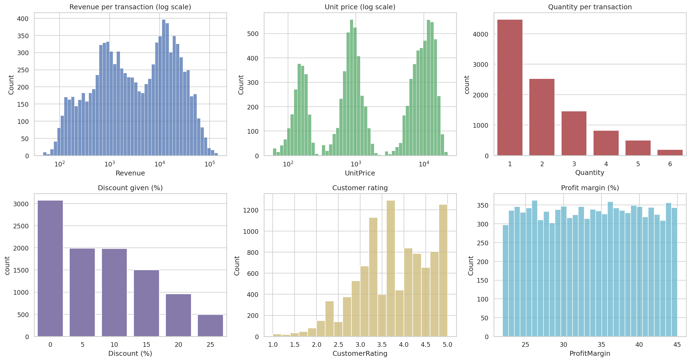
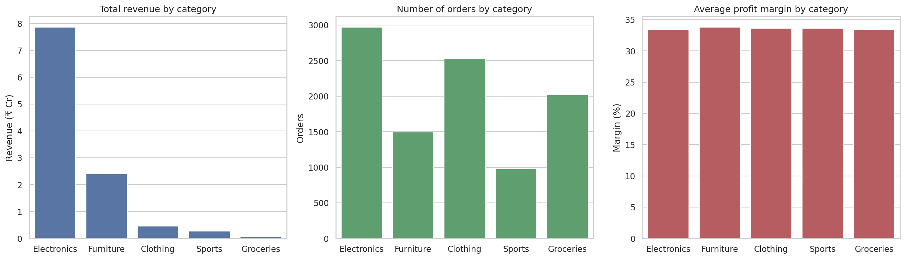
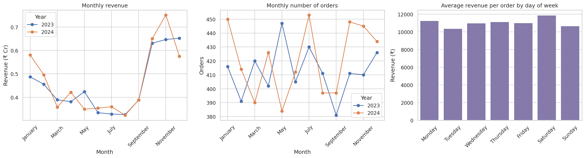
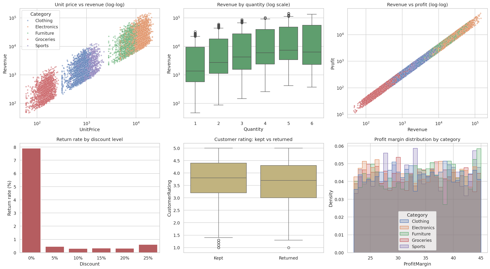

# Retail Sales Analysis: Data Preprocessing and EDA

A Python notebook that cleans a 10,000-row retail transactions dataset and explores it with NumPy, Pandas, Matplotlib and Seaborn. Built as the Month 1 project (Python basics and data manipulation) of a Data Science program.

## Objective

Take a raw sales file, check it properly, prepare it for analysis, and answer a simple set of questions: what sells, where, when, to whom, and what goes wrong (returns and low ratings).

## Dataset

`data/Retail_Sales_Dataset.csv` holds 10,000 transactions from 1 Jan 2023 to 31 Dec 2024.

| Group | Columns |
|---|---|
| Time | Date, Month, Quarter, Year |
| Location | City (10), Region (4) |
| Product | Category (5), ProductName (50) |
| Customer and channel | Channel (3), PaymentMethod (5), Gender (2) |
| Sales numbers | Quantity, UnitPrice, Discount, Revenue, Cost, Profit, ProfitMargin |
| Feedback | CustomerRating (1 to 5), Returned (0 or 1) |

The file has no currency column. I assumed the amounts are in INR.

## What the notebook covers

**Preprocessing**
- Missing value and duplicate checks (none found)
- Type fixes: `Date` to datetime, low-cardinality text columns to `category` (78% less memory), ordered `Month`
- Text consistency and Region/City mapping checks
- Ten logical consistency checks (for example `Profit = Revenue - Cost`), all passing
- Discovery of a month-level multiplier inside `Revenue` (1.20, 1.00, 0.85 or 1.60 depending on the month)
- IQR outlier detection, with the decision to keep high-ticket orders
- 13 new features: margin band, discount band, rating band, day of week, order size, log columns and more
- A cleaned file saved to `data/retail_sales_cleaned.csv`

**EDA**
- Headline KPIs and distributions of every numeric column
- Category, region, channel, payment, gender, city and product comparisons
- Monthly, quarterly, yearly and day-of-week trends
- Correlation heatmap, a six-panel relationship dashboard and a pairplot

## Key findings

- Electronics is about 30% of orders but **71% of revenue**. Electronics and Furniture together are about 93%.
- Profit margin is about **33.5% in every category**, so categories differ by sales volume and order size, not profitability.
- Q4 brings **35% of revenue** while monthly order counts stay flat, so the Q4 lift comes from the revenue multiplier and not from more orders.
- Channels, payment methods, gender and cities are almost evenly split.
- Revenue grew **3.0%** from 2023 to 2024 (₹5.44 Cr to ₹5.61 Cr).
- The return rate is 2.69%, but **7.9% for undiscounted orders** against about 0.4% for discounted ones. That is a pattern to test further, not proof of cause.
- Revenue follows unit price (correlation 0.73) and quantity (0.42). Customer rating is nearly uncorrelated with everything.

## Selected visuals






## Limitations

- The data looks generated rather than collected: margins are almost uniform between 22% and 45%, and the monthly multipliers are exact. Good for practice, not for real business conclusions.
- EDA shows association, not cause.
- There is no customer ID, so customer-level analysis is not possible.
- The currency and the way Revenue was built are inferred, not documented.

## Project structure

```
.
├── retail_sales_analysis.ipynb   # main notebook (outputs included)
├── data/
│   ├── Retail_Sales_Dataset.csv      # raw data
│   └── retail_sales_cleaned.csv      # output of the preprocessing section
├── images/                        # charts saved by the notebook
├── requirements.txt
└── README.md
```

## How to run

```bash
git clone https://github.com/samarthgupta95/retail-sales-python-analysis.git
cd retail-sales-python-analysis
pip install -r requirements.txt
jupyter notebook retail_sales_analysis.ipynb
```

Run the cells from top to bottom. Charts are written to `images/` and the cleaned data to `data/`.

## Tech stack

Python 3, NumPy, Pandas, Matplotlib, Seaborn, Jupyter

## Author

Samarth Gupta ([GitHub](https://github.com/samarthgupta95))
